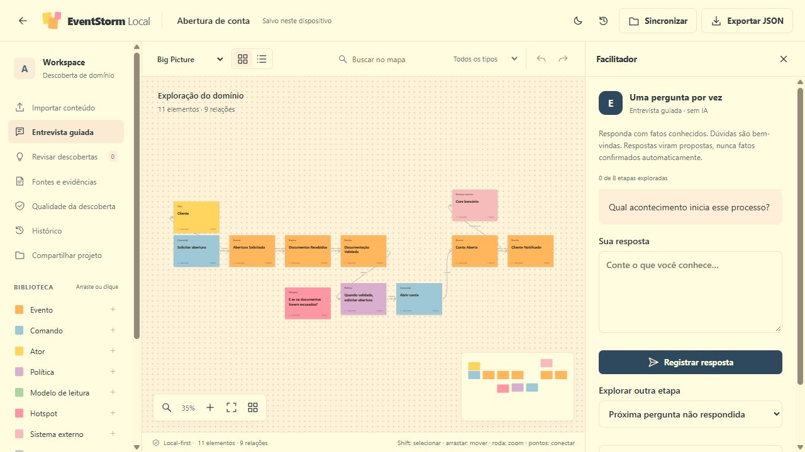

# Event Storm Local

Versão local-first do [EventStorming Studio](https://github.com/acomar/eventstorm-studio), em HTML, CSS e JavaScript nativos. O mapa, as fontes, as respostas do facilitador e o histórico ficam no navegador. A aplicação não usa banco de dados servidor, API de IA, framework, CDN, Docker ou pacotes de terceiros.

O facilitador é determinístico: organiza perguntas e propõe candidatos com evidências para revisão humana. Aceitar uma proposta adiciona conhecimento **Pendente**; só o especialista pode marcá-lo como **Validado**.



## Abrir a aplicação

O repositório inclui **`standalone.html`**, com os seis módulos da aplicação, CSS e ícone no próprio arquivo. Ele pode ser aberto por duplo clique, sem instalar Node.js, pacotes ou servidor. Esse modo dispensa service worker; todos os arquivos necessários já estão dentro do HTML. Persistência em `file://` depende das permissões do navegador e do perfil. A interface informa fallback de armazenamento; exporte backups quando a persistência não estiver disponível.

O arquivo único foi verificado via HTTP. A verificação direta de `file://` não foi executada porque a ferramenta de navegação deste ambiente permite apenas HTTP/HTTPS; veja os [resultados e limites](docs/TEST_REPORT.md).

Para usar a versão modular, sirva a pasta com qualquer servidor estático local. Há um servidor opcional feito apenas com módulos nativos do Node.js 22 ou posterior:

```sh
git clone https://github.com/acomar/event-storm-local.git
cd event-storm-local
npm start
```

Abra **http://127.0.0.1:8080**. Não é necessário executar `npm install` nem gerar um build. Também é possível usar `node scripts/serve.mjs` diretamente. Para outra porta no PowerShell: `$env:PORT='8081'; npm start`.

Use localhost ou hospedagem estática HTTPS para `index.html`. Abrir esse arquivo modular diretamente por `file://` não é o caminho suportado; use `standalone.html` para a edição de arquivo único. O servidor incluído serve arquivos e escuta somente no loopback; os dados do workshop continuam no navegador.

## Começar um workshop

1. Crie um projeto com nome e objetivo, ou abra o exemplo fictício de abertura de conta.
2. Monte o mapa com eventos, comandos, atores, políticas, regras, dúvidas e relações.
3. Use **Facilitador** para responder uma pergunta por vez, ou importe uma descrição TXT/Markdown.
4. Revise as propostas e suas evidências antes de aceitá-las. Dúvidas e hipóteses permanecem visíveis.
5. Salve versões para registrar marcos do trabalho e consulte **Histórico** para comparar ou restaurar.
6. Exporte um JSON do projeto ou um pacote de versões para manter um backup portátil. O blueprint Markdown reúne o mapa, as evidências e as lacunas registradas.

Salvar no dispositivo e sincronizar são ações diferentes. O autosave protege a cópia de trabalho local; **Salvar versão** cria um marco no histórico. A restauração cria uma nova versão, preservando as anteriores.

## Versões e compartilhamento

O motor compara JSON por campos e IDs estáveis. Mudanças independentes podem ser combinadas; mudanças diferentes no mesmo campo, remoção versus edição e ordens incompatíveis exigem decisão. A interface apresenta **Sua alteração**, **Alteração compartilhada** e o resultado, sem exigir edição de JSON.

Há exportação/importação de pacote de versões e um adaptador experimental para pasta escolhida pelo usuário, nos navegadores que expõem File System Access API. O handle da pasta é preservado quando o navegador permite; **Permitir acesso** tenta recuperar a permissão da pasta conhecida antes de pedir uma nova seleção.

Um pacote aberto em uma sessão nova recupera o projeto e seu histórico. Importar um pacote do mesmo projeto em uma sessão existente preserva o rascunho local como versão e integra os ramos pelo ancestral comum; diferenças pedem decisão. Históricos sem origem comum ou de outra base não substituem silenciosamente o trabalho atual. Conclua uma sessão de diferenças pendente antes de importar outra.

**A pasta experimental preserva publicações concorrentes em objetos imutáveis e anúncios separados.** Ela não oferece uma transação global entre computadores nem garante descoberta imediata de arquivos sincronizados por OneDrive/Drive/SharePoint. Depois de publicar, o estado continua pedindo verificação de outras alterações; não há confirmação global entre dispositivos. Não confunda isso com colaboração em tempo real ou suporte multiusuário certificado. Consulte a [matriz de capacidades](docs/CAPABILITIES.md).

## Dados e funcionamento offline

IndexedDB é o armazenamento principal. Se ele estiver indisponível, o aplicativo informa o fallback usado; memória temporária não equivale a persistência. Os dados são separados por origem: trocar porta, hostname, navegador ou perfil cria outro armazenamento. Limpar os dados do site, usar modo privado ou remover o perfil pode apagar o trabalho. Exporte backups regularmente.

O service worker conserva os arquivos estáticos depois do primeiro carregamento completo em uma origem compatível. A execução local não envia o conteúdo do workshop a serviços externos. Um backup do projeto preserva o grafo; um pacote de versões preserva também objetos e histórico. Nenhum deles inclui credenciais.

## Compatibilidade com o Studio

A importação aceita o contrato JSON `schema_version: "1.0"` do Studio: nós, relações, fontes, evidências, propostas, respostas e viewport. Importar como novo projeto cria identidade de projeto nova e mantém os IDs internos. Esquemas desconhecidos, referências quebradas e valores inválidos são rejeitados.

Há uma extensão local com cartões **Agregado**. Um projeto que usa esse tipo não é aceito pelo validador estrito do Studio original, embora mantenha a mesma estrutura básica. Para voltar ao Studio, use somente os 11 tipos originais, inclusive nas propostas. A extensão não deve ser confundida com compatibilidade integral de ida e volta.

A UI foi reconstruída sem React/XYFlow, mantendo os fluxos centrais e adicionando histórico persistente e blueprint. A [matriz de paridade](docs/PARITY.md) explicita diferenças. Não há LLM, análise de repositórios, importação PDF/DOCX/XLSX, contas ou serviço remoto de colaboração.

## Desenvolvimento e verificação

```sh
npm test
```

Os testes usam o runner nativo do Node.js e adapters controlados. A workflow de CI está configurada para executar a suíte em Node.js 22. O [relatório de testes](docs/TEST_REPORT.md) registra execuções efetivas e verificação pela interface. Testes do motor não certificam APIs de pasta, permissões ou compatibilidade de todos os navegadores; esses resultados ficam separados na [matriz de capacidades](docs/CAPABILITIES.md).

Depois de alterar os módulos, gere novamente o HTML único com `npm run standalone`. O gerador usa somente módulos nativos do Node.js e valida sintaxe, imports, exports e ordem de dependências. `npm test` verifica que o arquivo publicado corresponde às fontes. Essa geração é opcional para usar a aplicação modular; o arquivo único pronto já está versionado no repositório.

| Arquivo | Responsabilidade |
|---|---|
| `index.html`, `styles.css`, `js/app.js` | Interface e interações do workshop |
| `standalone.html` | Aplicação empacotada em um único arquivo HTML |
| `js/domain.js` | Contrato portátil e invariantes do grafo |
| `js/facilitator.js` | Descobertas, entrevista e inspeção determinísticas |
| `js/version-control.js` | Persistência local, histórico, diferenças e integração |
| `scripts/serve.mjs` | Servidor estático opcional, sem API de dados |
| `scripts/build-standalone.mjs` | Geração nativa e auditável do HTML único |
| `tests/` | Verificação automatizada |

Veja [arquitetura](docs/ARCHITECTURE.md), [skills aplicadas](docs/SKILLFORGE.md), [paridade](docs/PARITY.md) e [capacidades e limites](docs/CAPABILITIES.md).
