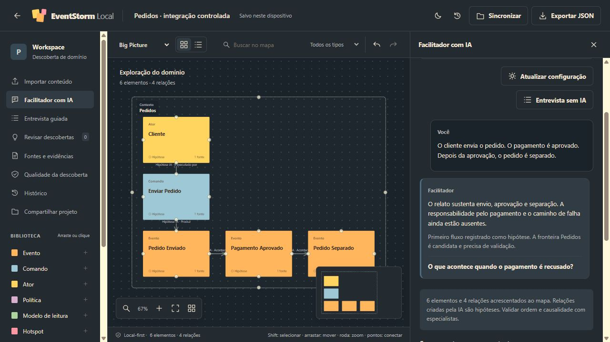
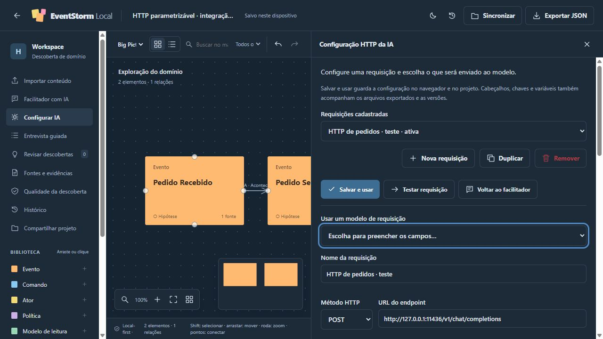

# Event Storm Local

Versão local-first do [EventStorming Studio](https://github.com/acomar/eventstorm-studio), em HTML, CSS e JavaScript nativos. O mapa, as fontes, as respostas do facilitador, as configurações HTTP e o histórico ficam no navegador. A aplicação não usa banco de dados servidor, framework, CDN, Docker ou pacotes de terceiros. A facilitação com IA é opcional e chama um endpoint configurado pela interface, diretamente no navegador ou pela ponte Node.js nativa.

O **Facilitador com IA** conversa sobre o domínio, questiona ambiguidades e registra hipóteses com evidências no mapa. Novos elementos entram como **Hipótese** ou **Contestado**; alterações de elementos existentes ficam para revisão. A **Entrevista guiada** é um roteiro de referência para iniciantes: oito perguntas em sequência com orientações, sem chat, registro de respostas, progresso ou geração de propostas. A extração de TXT/Markdown continua determinística e disponível sem modelo. Aceitar uma proposta adiciona conhecimento **Pendente**; só o especialista pode marcá-lo como **Validado**.



Captura da integração com respostas controladas de teste; não representa inferência de um modelo real.

Veja também a [captura do roteiro da Entrevista guiada](docs/assets/entrevista-guiada.jpg).

**Configurar IA** abre um editor inspirado no [HTTP Request do n8n](https://docs.n8n.io/integrations/builtin/core-nodes/n8n-nodes-base.httprequest/): múltiplas requisições, método, URL, autenticação, cabeçalhos, parâmetros, variáveis, corpo e campo da resposta. É possível testar a conexão, visualizar a requisição preenchida e importar/exportar configurações. **Salvar e usar** inclui a configuração e suas credenciais no navegador, no JSON do projeto e nas versões.



Captura de um perfil com endpoint e chave fictícios, usados somente para teste controlado.

## Abrir a aplicação

O repositório inclui **`standalone.html`**, com os oito módulos da aplicação, CSS e ícone no próprio arquivo. Ele pode ser aberto por duplo clique, sem instalar Node.js, pacotes ou servidor, para edição, entrevista guiada e histórico. Esse modo dispensa service worker; todos os arquivos necessários já estão dentro do HTML. Persistência em `file://` depende das permissões do navegador e do perfil. A interface informa fallback de armazenamento; exporte backups quando a persistência não estiver disponível. Para IA sem servidor do aplicativo, selecione **Direto no navegador** e use um endpoint que permita CORS para a origem da página.

O arquivo único foi verificado via HTTP. A verificação direta de `file://` não foi executada porque a ferramenta de navegação deste ambiente permite apenas HTTP/HTTPS; veja os [resultados e limites](docs/TEST_REPORT.md).

Para usar a versão modular, sirva a pasta com qualquer servidor estático local. Há um servidor opcional feito apenas com módulos nativos do Node.js 22 ou posterior:

```sh
git clone https://github.com/acomar/event-storm-local.git
cd event-storm-local
npm start
```

Abra **http://127.0.0.1:8080**. Não é necessário executar `npm install` nem gerar um build. Também é possível usar `node scripts/serve.mjs` diretamente. Para outra porta no PowerShell: `$env:PORT='8081'; npm start`.

Use localhost ou hospedagem estática HTTPS para `index.html`. Abrir esse arquivo modular diretamente por `file://` não é o caminho suportado; use `standalone.html` para a edição de arquivo único. O servidor incluído escuta somente no loopback, serve arquivos e oferece a ponte opcional de IA; os dados do workshop continuam persistidos no navegador.

Para ativar a conversa com IA, disponibilize um modelo ou workflow HTTP e abra **Configurar IA** conforme [AI_SETUP.md](docs/AI_SETUP.md). Há modelos de requisição para Ollama, LM Studio, Chat Completions e HTTP personalizado. O padrão Ollama aponta para `http://127.0.0.1:11434/v1/chat/completions` e `llama3.1:8b`; isso não instala nem baixa o modelo. **Testar requisição** verifica o endpoint e o formato retornado sem alterar o mapa. Variáveis de ambiente continuam disponíveis como configuração legada, quando não há requisição salva ativa.

## Começar um workshop

1. Crie um projeto com nome e objetivo, ou abra o exemplo fictício de abertura de conta.
2. Monte o mapa com eventos, comandos, atores, políticas, regras, dúvidas e relações.
3. Use **Facilitador com IA** para conversar e construir hipóteses no mapa, consulte **Entrevista guiada** como roteiro de perguntas para conduzir o workshop, ou importe uma descrição TXT/Markdown.
4. Revise as propostas e suas evidências antes de aceitá-las. Dúvidas e hipóteses permanecem visíveis.
5. Salve versões para registrar marcos do trabalho e consulte **Histórico** para comparar ou restaurar.
6. Exporte um JSON do projeto ou um pacote de versões para manter um backup portátil. O blueprint Markdown reúne o mapa, as evidências e as lacunas registradas.

Salvar no dispositivo e sincronizar são ações diferentes. O autosave protege a cópia de trabalho local; **Salvar versão** cria um marco no histórico. A restauração cria uma nova versão, preservando as anteriores.

### Cards e observações

Arraste o canto inferior direito de qualquer card para alterar sua largura e altura. Também é possível preencher **Largura** e **Altura** em seus detalhes, ou focar o canto e usar as setas (Shift aumenta o passo). As relações, a seleção, o ajuste do mapa e o minimapa acompanham as dimensões salvas. **Descrição / observação** aparece no próprio card; textos longos podem ser rolados ou lidos ao ampliar o card.

Clique no card e pressione **Delete** para apagar a seleção e suas relações. Shift permite selecionar vários cards. **Ctrl/Cmd+Z** desfaz, e **Ctrl/Cmd+Shift+Z** refaz. Enquanto um campo de texto está sendo editado, Delete continua editando o texto.

### Vários mapas por projeto

Use **Novo mapa** para criar um mapa dentro do projeto e o seletor **Mapa de eventos** para alternar entre eles. **Gerenciar mapas** permite abrir, renomear, duplicar e excluir mapas. Cada mapa preserva seus próprios cards, relações, fontes, evidências, propostas, conversa do facilitador, profundidade do workshop e viewport. A configuração HTTP da IA é compartilhada pelo projeto, e a IA recebe somente o mapa ativo.

Projetos antigos aparecem com um **Mapa principal**, preservando seus dados. O projeto sempre mantém pelo menos um mapa; ao excluir o principal, outro mapa assume essa posição com sua identidade preservada. Exclusões podem ser desfeitas ou recuperadas pelo histórico. JSON, backup com histórico e sincronização incluem todos os mapas; o blueprint é exportado para o mapa ativo. O limite de validação é de 1000 mapas por projeto, com os limites de elementos aplicados a cada mapa.

## Versões e compartilhamento

O motor compara JSON por campos e IDs estáveis. Mudanças independentes podem ser combinadas; mudanças diferentes no mesmo campo, remoção versus edição e ordens incompatíveis exigem decisão. A interface apresenta **Sua alteração**, **Alteração compartilhada** e o resultado, sem exigir edição de JSON.

Há exportação/importação de pacote de versões e um adaptador experimental para pasta escolhida pelo usuário, nos navegadores que expõem File System Access API. O handle da pasta é preservado quando o navegador permite; **Permitir acesso** tenta recuperar a permissão da pasta conhecida antes de pedir uma nova seleção.

Um pacote aberto em uma sessão nova recupera o projeto e seu histórico. Importar um pacote do mesmo projeto em uma sessão existente preserva o rascunho local como versão e integra os ramos pelo ancestral comum; diferenças pedem decisão. Históricos sem origem comum ou de outra base não substituem silenciosamente o trabalho atual. Conclua uma sessão de diferenças pendente antes de importar outra.

**A pasta experimental preserva publicações concorrentes em objetos imutáveis e anúncios separados.** Ela não oferece uma transação global entre computadores nem garante descoberta imediata de arquivos sincronizados por OneDrive/Drive/SharePoint. Depois de publicar, o estado continua pedindo verificação de outras alterações; não há confirmação global entre dispositivos. Não confunda isso com colaboração em tempo real ou suporte multiusuário certificado. Consulte a [matriz de capacidades](docs/CAPABILITIES.md).

## Dados e funcionamento offline

IndexedDB é o armazenamento principal. Se ele estiver indisponível, o aplicativo informa o fallback usado; memória temporária não equivale a persistência. Os dados são separados por origem: trocar porta, hostname, navegador ou perfil cria outro armazenamento. Limpar os dados do site, usar modo privado ou remover o perfil pode apagar o trabalho. Exporte backups regularmente.

O service worker conserva os arquivos estáticos depois do primeiro carregamento completo em uma origem compatível. Edição, entrevista guiada e histórico funcionam sem serviço de IA. Ao conversar com o Facilitador com IA, um recorte da conversa, das fontes e do mapa segue para o endpoint da requisição ativa. A configuração HTTP salva inclui cabeçalhos, autenticação e variáveis, inclusive chaves: esses dados acompanham o JSON do projeto, a exportação de configuração e o pacote de versões. As credenciais não entram automaticamente no contexto do modelo; entram nos campos HTTP que você parametrizar. Um backup do projeto preserva o grafo e a configuração; um pacote de versões preserva também objetos e histórico.

## Compatibilidade com o Studio

A importação aceita o contrato JSON `schema_version: "1.0"` do Studio: nós, relações, fontes, evidências, propostas, respostas e viewport. Importar como novo projeto cria identidade de projeto nova e mantém os IDs internos. Esquemas desconhecidos, referências quebradas e valores inválidos são rejeitados.

Há extensões locais com cartões **Agregado**, lados de conexão `source_side`/`target_side` e configuração opcional `ai_http`. O validador estrito do Studio original recusa esses valores/campos. Para voltar ao Studio, use somente os 11 tipos originais, inclusive nas propostas, relações sem esses campos locais e um projeto sem `ai_http`. Projetos antigos continuam sem essa extensão até salvar a configuração. A extensão não deve ser confundida com compatibilidade integral de ida e volta.

O suporte a vários mapas adiciona os campos locais opcionais `primary_map` (ID e nome do mapa principal) e `maps` (mapas adicionais com ID, nome, modalidade e grafo). O grafo principal continua em `graph`; o JSON nunca duplica o mesmo grafo entre campos. Projetos antigos sem esses campos continuam sendo importados e validados sem alteração do formato. O Studio original não aceita essa extensão de múltiplos mapas. Dimensões dos cards são propriedades opcionais `width` e `height`, incluídas no autosave, nos backups e nas versões.

A UI foi reconstruída sem React/XYFlow, mantendo os fluxos centrais e adicionando histórico persistente, blueprint, áreas de contexto redimensionáveis e conexões pelos quatro lados dos cartões. A [matriz de paridade](docs/PARITY.md) explicita diferenças. A IA depende de um modelo externo configurado; não há análise de repositórios, importação PDF/DOCX/XLSX, contas ou serviço remoto de colaboração.

## Desenvolvimento e verificação

```sh
npm test
```

Os testes usam o runner nativo do Node.js e adapters controlados. A workflow de CI está configurada para executar a suíte em Node.js 22. O [relatório de testes](docs/TEST_REPORT.md) registra execuções efetivas e verificação pela interface. Testes do motor não certificam APIs de pasta, permissões ou compatibilidade de todos os navegadores; esses resultados ficam separados na [matriz de capacidades](docs/CAPABILITIES.md).

Depois de alterar os módulos, gere novamente o HTML único com `npm run standalone`. O gerador usa somente módulos nativos do Node.js e valida sintaxe, imports, exports e ordem de dependências. `npm test` verifica que o arquivo publicado corresponde às fontes. Essa geração é opcional para usar a aplicação modular; o arquivo único pronto já está versionado no repositório.

| Arquivo | Responsabilidade |
|---|---|
| `index.html`, `styles.css`, `js/app.js` | Interface e interações do workshop |
| `standalone.html` | Aplicação empacotada em um único arquivo HTML |
| `js/domain.js` | Contrato portátil e invariantes do grafo |
| `js/facilitator.js` | Roteiro de perguntas, extração e inspeção determinísticas; compatibilidade com respostas antigas |
| `js/ai-facilitator.js` | Conversa com IA, contrato de resposta e hipóteses rastreáveis |
| `js/http-request.js` | Perfis HTTP, parametrização declarativa, execução e leitura de respostas |
| `js/version-control.js` | Persistência local, histórico, diferenças e integração |
| `scripts/serve.mjs` | Servidor estático e ponte opcional de IA, sem persistência de workshop |
| `scripts/build-standalone.mjs` | Geração nativa e auditável do HTML único |
| `tests/` | Verificação automatizada |

Veja [configuração de IA](docs/AI_SETUP.md), [contrato do facilitador com IA](docs/AI_FACILITATOR_SKILL.md), [arquitetura](docs/ARCHITECTURE.md), [skills aplicadas](docs/SKILLFORGE.md), [paridade](docs/PARITY.md) e [capacidades e limites](docs/CAPABILITIES.md).
